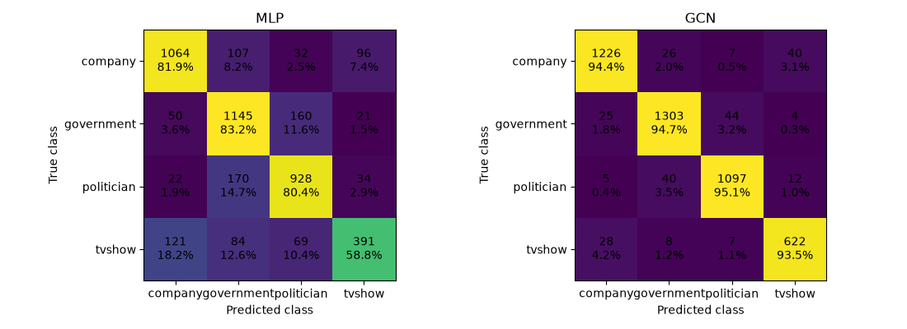
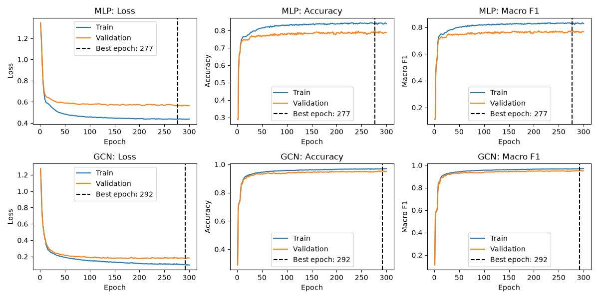
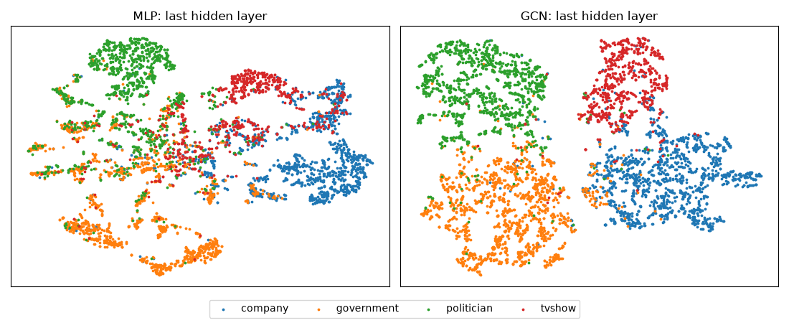
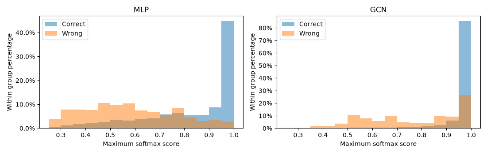

# Facebook Page Classification: MLP and Multi-layer GCN

Xiang Luo · 49109715 · COMP3710

## 1. Project overview and working principles

This project uses a Graph Convolutional Network (GCN) to classify Facebook pages as company, government, politician or tvshow. It combines page features and graph connections to help reviewers check page categories. An MLP is used as the baseline. The comparison covers classification performance, confidence and computational cost. The project also examines a rule for sending uncertain predictions for human review.

Each GCN layer first applies a linear transformation to node features. It then aggregates information from the node itself and its direct neighbours, using coefficients calculated from node degrees, and adds a bias. All nodes share the transformation weights within a layer, while each layer learns its own weights. Stacking these layers allows information from more distant neighbours to reach a node through intermediate nodes. The final layer produces four class scores, which Softmax converts into class probabilities. [2,3]


### Model construction

The GCN is written in PyTorch using custom `nn.Module` classes, based on the GCN paper and PyG's `GCNConv`. Each convolution is implemented in three parts: `nn.Linear` for feature transformation, `index_add_` for neighbour aggregation, and a learnable bias. The aggregation coefficient is `1 / sqrt(d_i * d_j)`, where node degrees include self-loops. The transformation weights and biases are learned during training. [2,3]

| Model | Selected architecture | Trainable parameters |
| --- | --- | ---: |
| MLP baseline | 128 → 64 → 64 → 4 | 12,676 |
| GCN main model | 128 → 64 → 64 → 64 → 4 | 16,836 |

Both models apply dropout before each layer and ReLU after each hidden layer. The final layer outputs class scores. Dropout is disabled during prediction. The GCN layer count is controlled by the hyperparameter `depth`; the table shows the architectures selected using the validation set.

## 2. Feasibility review

### Purpose and success criteria

The proposed Multi-layer GNN project (Normal difficulty) will help network analysts classify Facebook pages as company, government, politician or tvshow and refer uncertain predictions for human review.

- Test accuracy and macro F1 of at least 90%, with at least 85% recall in every class.
- At least 95% accuracy among the 90% or more predictions handled automatically. Select the confidence threshold on validation data.
- Whole-graph inference under 20 ms and peak training GPU allocation under 537 MB.

These are project targets, not course pass thresholds.

### Data and proposed approach

The dataset contains 22,470 pages, 128 features per page and 342,004 stored edge entries. Class counts are 6,495 company, 6,880 government, 5,768 politician and 3,327 tvshow. The stratified 70/10/20 split contains 15,729 training, 2,247 validation and 4,494 test nodes. The learning setting is transductive. Convert features to float32 and labels and edge indices to integer tensors, then load them into a PyG Data object. Use self-loops and degree normalisation.

Compare a three-layer MLP using page features with a GCN that also uses connections. Both train for 200 epochs with full batches, Adam and unweighted cross-entropy. Validation macro F1 selects the settings from 27 MLP and 405 GCN combinations.

- **MLP:** 128 → 64 → 64 → 4; learning rate 0.01, dropout 0.2, weight decay 0.0005.
- **GCN:** 128 → 32 → 32 → 32 → 4; learning rate 0.02, dropout 0.2, weight decay 0; validation macro F1 94.86%.

An equivalent graph convolution layer was also written as a custom PyTorch `nn.Module`, using PyG's `GCNConv` as a reference. The preliminary search and results below came from the original PyG implementation.

### Initial feasibility evidence

| Measure | MLP | GCN |
| --- | ---: | ---: |
| Test accuracy | 79.28% | 94.26% |
| Test macro precision | 78.47% | 93.93% |
| Test macro recall | 77.12% | 94.08% |
| Test macro F1 | 77.64% | 93.99% |
| Test macro AUROC | 0.9489 | 0.9923 |
| Recorded training time, 200 epochs | 0.57 s | 2.22 s |
| Peak PyTorch GPU allocation | 80.2 MB | 180.9 MB |
| Whole-graph inference | 0.094 ms | 3.02 ms |

GCN recall is 92.76% for company, 96.37% for government, 94.11% for politician and 93.08% for tvshow. These preliminary results meet the classification and resource targets. The confidence-based review target still needs evaluation.

### Risks and next steps

Inspect 3–5 representative validation errors, including confident mistakes, and compare them with low-confidence correct cases. Examine confidence, node degree, training-labelled neighbour classes and validation t-SNE positions. Use validation data to choose a review threshold, then report test coverage, accepted-prediction accuracy and review counts by class.

Test feature standardisation using training-node statistics and try Jumping Knowledge (JK). Consider Graph Attention Network (GAT) if resources allow. Change one component at a time on the same split and three seeds, comparing classification, confidence and computational cost. Select on validation data before testing the selected models. Small probes used 324 MB for JK and 748 MB for GAT; GAT exceeds the memory target, so prioritise JK and feature scaling. These probes have not established an accuracy gain.

## 3. Environment, usage and reproducibility

### Dependencies and hardware

| Dependency | Version used |
| --- | --- |
| Python | 3.11.17 |
| PyTorch / CUDA build | 2.8.0+cu128 / 12.8 |
| PyG | 2.8.1 |
| NumPy | 2.4.6 |
| scikit-learn | 1.9.1 |
| matplotlib | 3.11.2 |
| SciPy | 1.17.1 |

Training hardware: NVIDIA GeForce RTX 5070.

Use a Python 3.11 environment. Install PyTorch with CUDA 12.8, then install the remaining dependencies.

```bash
python -m pip install torch==2.8.0 --index-url https://download.pytorch.org/whl/cu128
python -m pip install -r requirements.txt
python -m pip install matplotlib==3.11.2 scipy==1.17.1
```

PyTorch installation reference: https://pytorch.org/get-started/previous-versions/

### Running the project

Keep source code, this README and report figures in Git. Keep datasets and generated results locally. `.gitignore` excludes search outputs, checkpoints, training records, predictions and embeddings.

1. Open a terminal in `recognition/GCN_Facebook_s4910971`.
2. Download the 128-dimensional dataset from the Gayanku repository [1]. Save it as `data/facebook.npz`. Keep the fields `X`, `y`, `edges_x` and `edges_y`.
3. Run search, training and prediction in order for each model.
4. Replace each example checkpoint path with the new `model.pt` path created by training.

Search regenerates `summary.csv` and `best_params.txt`. Training saves the checkpoint and history. Prediction saves metrics, node predictions and embeddings.

```bash
# MLP baseline
python experiments/baseline/search.py
python experiments/baseline/train.py
python experiments/baseline/predict.py --model "training_results/mlp_YYYYMMDD_HHMMSS/model.pt"

# GCN main model
python experiments/main/search.py
python train.py
python predict.py --model "training_results/gcn_YYYYMMDD_HHMMSS/model.pt" --threshold 0.85
```

### Regenerating figures and analysis

Generate predictions for both models first. Then update the paths at the top of the scripts:

- In each plotting script, set `RUNS` to the new MLP and GCN run directories.
- In `experiments/threshold/analyse.py`, set `RUN` to the new GCN run directory.
- Keep `SPLIT="test"` for the confusion matrix, t-SNE and confidence plots. Keep `SPLIT="val"` for threshold analysis.

Run:

```bash
python plots/training_curves.py
python plots/confusion_matrix.py
python plots/tsne.py
python plots/confidence_distribution.py
python experiments/threshold/analyse.py
```

Find the figures in `plots/figures/`. Read the threshold comparison in the terminal.

### Configuration and saved results

- Keep `USE_SEARCH=True` to read `search_results/best_params.txt`. Set it to `False` to use the training script's `PARAMS`.
- Match `SEED` and `EPOCHS` in the search and training scripts. Use seed 0 and 300 epochs to reproduce the reported settings. Both models use full batches.
- Use `--model` to select a checkpoint. Prediction restores the model settings and split seed from it. The checkpoint also records the best epoch.
- Use the GCN's `--threshold` to set the review threshold. The default is 0.85. Predictions below it are saved in `low_confidence.csv`.

| Local output location | Files |
| --- | --- |
| `experiments/baseline/search_results/` | `summary.csv`, `best_params.txt` |
| `experiments/main/search_results/` | `summary.csv`, `best_params.txt` |
| `training_results/mlp_.../` or `training_results/gcn_.../` | `params.txt`, `history.csv`, `train_info.txt`, `model.pt` |
| Each run's `prediction/` folder | `predictions.csv`, `metrics.txt`, `embeddings.pt`, `predict_info.txt` |
| GCN run's `prediction/` folder | Also contains `low_confidence.csv` |

Reported runs: MLP `mlp_20261030_000036`; GCN `gcn_20261030_002758`. New runs have different timestamps. Train locally to create the checkpoints. Allow for small numerical differences from GPU operations.

## 4. Example inputs, outputs and visualisations

### Input

In `facebook.npz`, `X` stores node features, while `edges_x` and `edges_y` store the node indices at each end of an edge. After conversion to tensors, the GCN receives:

| Tensor | Shape | Meaning |
| --- | --- | --- |
| `x` | 22,470 × 128 | Each row contains one page's features |
| `edge_index` | 2 × 342,004 | Each column contains the endpoints of one edge entry |

### Example predictions

The GCN outputs four class scores per node and applies Softmax to calculate probabilities. The following examples are saved test predictions with a review threshold of 0.85:

| Node | True class | Prediction | Confidence | Action |
| ---: | --- | --- | ---: | --- |
| 2 | company | company | 99.98% | Automatic processing |
| 17970 | company | tvshow | 36.18% | Human review |

Node 2 is classified correctly and handled automatically. Node 17970 has low confidence in its predicted class and is flagged for human review.

## 5. Preprocessing, data splits and leakage control

### Dataset

The project uses the course-specified Gayanku FacebookPagePage dataset, stored as `data/facebook.npz`. [1]

| Nodes | Features per node | Page relations |
| ---: | ---: | ---: |
| 22,470 | 128 | 171,002 |

| company | government | politician | tvshow |
| ---: | ---: | ---: | ---: |
| 6,495 | 6,880 | 5,768 | 3,327 |

The released features have already been reduced to 128 dimensions using SVD. The loader converts features to `float32`, labels and edge indices to integer tensors, then constructs a PyG `Data` object.

### Splits and their roles

Nodes are split using stratified sampling with seed 0. MLP and GCN use the same split, and the three node sets do not overlap.

| Split | Share | Nodes |
| --- | ---: | ---: |
| Training | 70% | 15,729 |
| Validation | 10% | 2,247 |
| Test | 20% | 4,494 |

The training set is used to learn weights. The validation set is used to select hyperparameters, checkpoint epochs and the review threshold. The selected models are then compared on the test set. This split keeps most labelled nodes for training and reserves separate nodes for model selection and evaluation. Stratification maintains the class proportions across the three sets.

### Leakage control

The learning setting is transductive semi-supervised node classification, with features and connections retained for the whole graph. The GCN receives only features `x` and connections `edge_index`. Labels are not input features or neighbour messages. Training loss is calculated only for nodes selected by `train_mask`; validation and test labels do not contribute to gradient updates.

## 6. Investigation of the Open Research Dilemma

### 6.1 Model selection and training settings

#### Grid search

| Hyperparameter | MLP | GCN |
| --- | --- | --- |
| Number of layers | Fixed at 3 linear layers | [2, 3, 4, 6, 8] graph convolution layers |
| Hidden width | [16, 32, 64] | [16, 32, 64] |
| Learning rate | [0.005, 0.01, 0.02] | [0.005, 0.01, 0.02] |
| Dropout | [0.2, 0.5, 0.7] | [0.2, 0.5, 0.7] |
| Weight decay | Fixed at 0.0005 | [0, 0.0005, 0.005] |
| Combinations | 27 | 405 |

Each combination is trained for 300 epochs. Hyperparameters and checkpoint epochs are selected by validation macro F1. Lower validation loss breaks ties.

#### Selected training settings

| Setting | MLP | GCN |
| --- | --- | --- |
| Learning rate | 0.02 | 0.02 |
| Dropout | 0.2 | 0.2 |
| Weight decay | 0.0005 | 0 |
| Epochs / seed | 300 / 0 | 300 / 0 |
| Batch size / optimiser | Full batch / Adam | Full batch / Adam |
| Loss | Unweighted cross-entropy | Unweighted cross-entropy |
| Saved checkpoint epoch | 277 | 292 |

Both models start from random initialisation. Dropout is enabled during training and disabled during validation and prediction.

### 6.2 Test-set classification results

GCN achieves 94.53% test accuracy, 16.02 percentage points higher than MLP. Macro F1 improves by 17.63 percentage points. The number of errors falls from 966 to 246.

| Model | Accuracy | Macro precision | Macro recall | Macro F1 | AUROC |
| --- | ---: | ---: | ---: | ---: | ---: |
| MLP | 78.50% | 77.72% | 76.08% | 76.68% | 0.9443 |
| GCN | 94.53% | 94.21% | 94.42% | 94.31% | 0.9922 |

AUROC is the macro one-vs-rest score.

| Class | MLP precision / recall / F1 | GCN precision / recall / F1 |
| --- | --- | --- |
| company | 84.65% / 81.91% / 83.26% | 95.48% / 94.38% / 94.93% |
| government | 76.03% / 83.21% / 79.46% | 94.63% / 94.69% / 94.66% |
| politician | 78.05% / 80.42% / 79.21% | 94.98% / 95.06% / 95.02% |
| tvshow | 72.14% / 58.80% / 64.79% | 91.74% / 93.53% / 92.63% |



*Rows show true classes and columns show predicted classes. Each cell contains the node count and percentage within its true class.*

Both models show noticeable confusion between tvshow and company, and between politician and government.

### 6.3 Training curves and computational cost



*Training and validation curves over 300 epochs. Black dashed lines mark the saved checkpoint epochs selected by validation performance.*

| Resource, measured on RTX 5070 | MLP | GCN |
| --- | ---: | ---: |
| Trainable parameters | 12,676 | 16,836 |
| Training and validation time (seconds) | 2.0219 | 5.7566 |
| Peak PyTorch GPU allocation (MB) | 80.23 | 459.18 |
| Whole-graph inference time (ms) | 0.0946 | 3.8755 |

Training time includes validation at every epoch. Inference time is the average whole-graph forward-pass time after warm-up. GPU memory is the peak allocation recorded by PyTorch; MB uses 1,000,000 bytes.

### 6.4 Hidden representations and confidence

#### t-SNE embeddings



*The 64-dimensional hidden representations of the same 4,494 test nodes are reduced to two dimensions using t-SNE. Colours show ground-truth classes; perplexity = 30 and seed = 0. [4]*

With graph connections included, the classes are easier to distinguish in the representation space. MLP relies only on each node's 128 features, and the four classes are heavily mixed in the central region, with less clear boundaries. GCN aggregates information from connected pages, which often share the same class, so their representations become closer together. The classes form more compact, more clearly separated clusters, with fewer mixed regions. Some overlap remains, particularly between company and the government and tvshow groups. Graph information helps separate the classes, although some ambiguity remains between them.

#### Research question 1: Does confidence indicate whether a prediction is correct?



*Maximum Softmax scores for correct and incorrect test predictions. Percentages are calculated separately within each group, so each group's bars sum to 100%. Blue shows correct predictions and orange shows incorrect predictions.*

| Test statistic | MLP | GCN |
| --- | ---: | ---: |
| Mean confidence of correct predictions | 83.22% | 96.94% |
| Mean confidence of incorrect predictions | 58.04% | 77.13% |
| Confidence ≥ 0.9: incorrect / total high-confidence predictions | 60 / 1,948 | 88 / 3,973 |

In both models, correct predictions generally have higher confidence than incorrect ones. Most correct predictions are concentrated near a confidence of 1.0, while incorrect predictions are spread more widely across lower confidence ranges. This suggests that higher confidence is generally associated with a greater chance of being correct. GCN is more confident on average when its predictions are correct. However, it also makes high-confidence mistakes, with 88 such errors compared with 60 for MLP.

### 6.5 Representative failure cases

| Case and page | True class | MLP prediction | GCN prediction |
| --- | --- | --- | --- |
| 1. William Hague, node 7157 | politician | politician (99.45%) | government (99.99%) |
| 2. Army Knowledge Online / Defense Knowledge Online, node 13095 | company | government (97.42%) | government (>99.99%) |
| 3. Fidelity Investments, node 12975 | company | company (99.97%) | tvshow (97.28%) |

In cases 1 and 3, the models disagree, and MLP is correct in both cases. Inspecting the graph shows that 62 of case 1's 72 neighbours belong to government (86.1%). Case 3 has only one neighbour, NH Chronicle, which belongs to tvshow. In case 1, the features aggregated from its many government neighbours may shift its representation towards government. This may reduce the influence of its own features that help distinguish politician pages. In case 3, the features of its only neighbour, which belongs to another class, may lead GCN to predict tvshow.

For case 2, 110 of its 112 neighbours belong to government (98.2%). Its five closest training nodes, measured using Euclidean distance, also all belong to government. This suggests that both its own features and its neighbourhood are closer to government, which may explain why both models make high-confidence mistakes.

### 6.6 Human-review threshold and workload

Of the seven thresholds tested, 0.85 refers 8.99% of validation nodes for review, with 97.56% accuracy among automatically handled predictions. This makes it a candidate threshold for a review budget of about 10%.

| Threshold | Automatic-processing accuracy | Nodes for review | Review share |
| ---: | ---: | ---: | ---: |
| 0.70 | 96.68% | 111 | 4.94% |
| 0.80 | 97.26% | 169 | 7.52% |
| 0.85 | 97.56% | 202 | 8.99% |
| 0.90 | 97.98% | 271 | 12.06% |
| 0.95 | 98.43% | 403 | 17.94% |
| 0.97 | 98.68% | 511 | 22.74% |
| 0.99 | 99.30% | 810 | 36.05% |

*Results use 2,247 validation nodes. Predictions with confidence at or above the threshold are handled automatically; the rest are referred for review. Accuracy is calculated within the automatically handled group. Review share is the percentage of all validation nodes referred for review.*

Increasing the threshold from 0.85 to 0.95 improves automatic-processing accuracy by only 0.87 percentage points, while the review count almost doubles from 202 to 403. At 0.99, accuracy exceeds 99%, but the proportion requiring human review also increases substantially.

With the threshold fixed at 0.85 based on the validation results, 4,108 of the 4,494 test nodes (91.41%) are handled automatically, with 97.25% accuracy. The remaining 386 nodes (8.59%) are referred for human review. This meets the project targets of handling at least 90% of predictions automatically with at least 95% accuracy in that group.

### 6.7 Engineering recommendation and limitations

#### Research question 3: Is the GCN's additional cost worthwhile?

Compared with MLP, GCN adds 4,160 parameters, 378.95 MB of peak GPU allocation and approximately 3.78 ms of whole-graph inference time, while improving test accuracy by 16.02 percentage points. On the current graph and RTX 5070, the improvement in accuracy is worth the extra computation.

#### Recommendation to the project manager

GCN is recommended for this classification task because it substantially improves classification performance at a manageable computational cost on the current hardware. If human review should cover about 10% of cases, 0.85 can be used as an initial threshold. Some incorrect predictions still pass the threshold: even at 0.99, the validation error rate among automatically handled predictions is about 0.70%.

#### Limitations

The current model uses a transductive setting and achieves good classification results on the known graph. During training, it can access the features and connections of all nodes, including validation and test nodes, while the training loss uses only training labels. The results mainly show how well the model predicts withheld node labels on the known graph. Performance on an entirely unseen graph remains unknown. Accuracy may decrease if the feature distribution or connection patterns change. To assess generalisation to new graphs, the model would need to be evaluated independently on graphs that were unavailable during training.

## 7. Artificial Intelligence Usage Disclosure

I used Codex and GPT-6.1 to help generate the initial versions of search.py, train.py, and predict.py for both the GCN and baseline implementations. Before generating the code, I set the main experiment settings, including the hyperparameters and candidate values for the grid search, the combinations to test, the number of training epochs, and the random seed. I also chose the Adam optimiser and its learning rate and weight decay settings. The method for selecting the best parameters and using them in training was specified by me or agreed through discussion with AI.

I specified a transductive learning setup with full-batch training on my local GPU and no early stopping. The loss function, training and validation metrics, and use of dropout and softmax were also specified or confirmed through these discussions. Dropout was enabled during training and disabled during prediction, while softmax was used to obtain class probabilities.

To support later plotting and analysis, I requested that training and validation metrics be recorded at every epoch. I also discussed with AI what other information to save, including model weights, experiment settings, predictions, and runtime information, as well as the saving methods and file formats. Most other implementation choices were also discussed with me before being confirmed.

After the initial code was generated, I reviewed it based on my understanding of the training and prediction process. I rewrote some sections to make them easier for me to follow and addressed potential issues. For example, I changed the model-saving procedure to save the model from the epoch with the best validation performance instead of the final epoch. I compared the results from the two approaches and found little difference. I also checked whether the code followed the intended transductive setup, focusing on how training, validation, and test labels were used and whether their use could introduce data leakage.
## References

[A] COMP3710 / COMP7710 Final Assessment Specification v2.5, Sections 2.1, 3, 5.3 and 6.1.

[1] Gayanku course-modified FacebookPagePage dataset:
https://github.com/gayanku/facebook_page-page_dataset

Original dataset description:
https://snap.stanford.edu/data/facebook-large-page-page-network.html

[2] Kipf, T. N. and Welling, M. *Semi-Supervised Classification with Graph Convolutional Networks*. ICLR 2017.
https://arxiv.org/abs/1609.02907

[3] PyG GCNConv documentation:
https://pytorch-geometric.readthedocs.io/en/latest/generated/torch_geometric.nn.conv.GCNConv.html

[4] van der Maaten, L. and Hinton, G. *Visualizing Data using t-SNE*. JMLR 2008.
https://www.jmlr.org/papers/v9/vandermaaten08a.html

[5] Guo, C. et al. *On Calibration of Modern Neural Networks*. ICML 2017.
https://arxiv.org/abs/1706.04599

[6] Geifman, Y. and El-Yaniv, R. *Selective Classification for Deep Neural Networks*. NeurIPS 2017.
https://arxiv.org/abs/1705.08500
